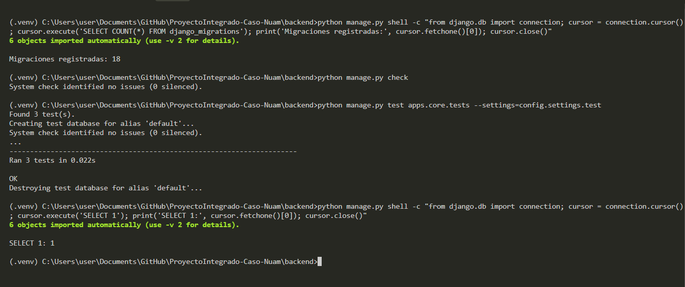

# Evidencia: migraciones técnicas de Django en Supabase

## Objetivo

Validar la conexión entre Django y PostgreSQL administrado por Supabase, aplicando exclusivamente las migraciones técnicas del framework.

## Entorno

- Python: 3.11.9
- Django: 5.2.19
- Psycopg: 3.1.19
- PostgreSQL: Supabase mediante Session Pooler
- Pruebas automáticas: SQLite en memoria

## Migraciones aplicadas

- admin: 3
- auth: 12
- contenttypes: 2
- sessions: 1
- total esperado: 18

## Resultado

Todas las migraciones fueron aplicadas correctamente.

## Tablas técnicas creadas

- auth_group
- auth_group_permissions
- auth_permission
- auth_user
- auth_user_groups
- auth_user_user_permissions
- django_admin_log
- django_content_type
- django_migrations
- django_session

## Validaciones

- Django system check: correcto.
- Conexión PostgreSQL: correcta.
- SELECT 1: correcto.
- Pruebas de core: 3 aprobadas.
- Base de pruebas: SQLite en memoria.

## Consideración arquitectónica

Las tablas `auth_*` se mantienen como infraestructura técnica del framework. Supabase Auth continúa siendo la única autoridad de credenciales para los usuarios de la plataforma nuam, según ADR-001.

No se ejecutó `createsuperuser` y no se crearon usuarios operacionales mediante Django.

